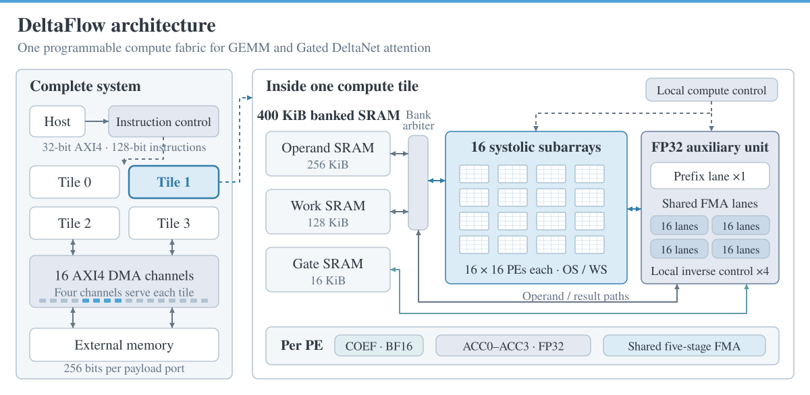

# DeltaFlow: Extending Systolic Arrays from GEMM to Gated DeltaNet Attention

[](LICENSE) [](https://github.com/chipsalliance/chisel) [](https://github.com/ucb-bar/chipyard)

DeltaFlow is a systolic accelerator for GEMM and Gated DeltaNet (GDN) attention. This repository contains its Chisel RTL, Python software stack, Chipyard integration, and simulation and synthesis scripts.

The same hardware supports GEMM, GDN chunk prefill, single-token decode and cached-correction replay. All modes use one instruction set, while each tile has its own SRAM and HBM ports.

- Four 64 × 64 systolic tiles provide 16,384 main MACs per cycle.
- GDN execution overlaps preparation for the next chunk with the current chunk's state and output computations.
- Each tile has 400 KiB of SRAM and four 256-bit AXI4 payload ports.
- Matrix operands use BF16; state and accumulation use FP32; GDN outputs use BF16.
- The Python compiler generates 128-bit instructions for compute, DMA and fences.

<p align="center"></p>

GDN execution interleaves input-dependent preparation for the next chunk with the current chunk's state-dependent work, while reusing state and intermediate results within each chunk. The animation illustrates these execution relationships; its playback speed does not represent hardware cycles. See [Architecture](docs/architecture.md) for the shared resources and recurrence constraints. A [GIF version](docs/assets/gdn_execution.gif) is also available.

## 🗂️ Repository layout

```text
.
├── rtl/                         Chisel RTL and integration
│   ├── src/main/scala/deltaflow/ Compute, memory, DMA and instruction control
│   ├── chipyard/                Direct AXI4 integration and simulation harness
│   └── memory_models/           Project-generated SRAM models
├── generated/                   Included four-tile SystemVerilog
├── software/deltaflow/          Instruction compiler, data layouts and MMIO API
├── examples/                    GEMM, prefill, decode and replay workloads
├── scripts/                     Build, simulation, synthesis and STA tools
├── docs/                        Architecture, programming and setup guides
│   └── assets/                  Figures used by the README and documentation
├── profiles/                    GPU and TPU traces with viewing instructions
├── reference/                   Selected mapped netlist for optional STA reruns
├── licenses/                    Third-party license texts
├── requirements.txt             Python dependencies
└── LICENSE                      Apache-2.0 license
```

## 🛠️ Setup

RTL simulation requires Linux, Python, NumPy, GCC/G++, Make and Verilator. Tested versions and installation options are listed in [Environment](docs/environment.md).

From the project root:

```bash
python3 -m venv .venv
source .venv/bin/activate
python -m pip install -r requirements.txt
source scripts/env.sh
```

You can simulate the included SystemVerilog directly. To regenerate it from Chisel, install the Chipyard and EasyFloat dependencies described in [Integration](docs/integration.md).

## 🚀 RTL simulation

### 1. Build the simulator

```bash
BUILD_JOBS=32 SIM_THREADS=8 bash scripts/build_sim.sh
```

This builds the complete four-tile Chipyard system with functional SRAM models and enabled hardware assertions. The binary is `.local/sim/chipyard_hbm`.

### 2. Run GEMM

Each tile computes an independent matrix using a shared shape and instruction stream. Larger matrices are split into output patches and K segments.

```bash
python examples/generate.py gemm --m 256 --n 256 --k 2048 --out .local/examples/gemm
python scripts/run_sim.py .local/examples/gemm
```

### 3. Run GDN prefill

This example uses four heads, Dk = Dv = 128 and chunk = 64. H remains in SRAM between chunks; O and the final H are exported to HBM.

```bash
python examples/generate.py prefill --tokens 1024 --out .local/examples/prefill
python scripts/run_sim.py .local/examples/prefill
```

### 4. Run decode and replay

Decode processes actual single tokens without expanding each token to a C64 chunk. Replay restores a checkpoint and reconstructs H from K, decay and corrected E saved by earlier accelerator execution.

```bash
python examples/generate.py decode --decode-tokens 4 --out .local/examples/decode
python scripts/run_sim.py .local/examples/decode

python examples/generate.py replay --accepted 2 --out .local/examples/replay
python scripts/run_sim.py .local/examples/replay
```

All tensor data comes from the external HBM image. The testbench compares actual HBM writes against ordered numerical expectations and reports cycles, DMA traffic and main-array utilization. See [Simulation](docs/simulation.md) for fixture formats, AXI modeling and additional workload options.

## 🏗️ Architecture and programming

The Chisel implementation is under [rtl/src/main/scala/deltaflow](rtl/src/main/scala/deltaflow). The core top is [FourTileSystem.scala](rtl/src/main/scala/deltaflow/system/FourTileSystem.scala). The Chipyard integration is [DirectAXI4.scala](rtl/chipyard/src/main/scala/deltaflow/integration/DirectAXI4.scala).

Each tile contains sixteen independently controlled 16 × 16 systolic subarrays and 65 auxiliary FP32 lanes. Each PE has one BF16 coefficient register (**COEF**) and four FP32 accumulation registers (**ACC0–ACC3**). GEMM uses OS accumulation; GDN applies triangular transforms in WS mode and computes state and output updates in OS mode.

<p align="center"></p>

The Python API is under [software/deltaflow](software/deltaflow). Compile programs to generate instruction files:

```bash
python -m deltaflow gemm --m 8192 --n 512 --k 2560 --output .local/programs/projection.hex
python -m deltaflow prefill --chunks 128 --output .local/programs/prefill8k.hex
```

See [Architecture](docs/architecture.md) for the datapath and fixed SRAM budget, and [Programming](docs/programming.md) for all 15 opcodes, instruction fields, data layouts and the MMIO submission/completion interface.

## 🧩 Build from Chisel

DeltaFlow is written in [Chisel](https://github.com/chipsalliance/chisel) and uses [EasyFloat](https://github.com/VCA-EPFL/easyfloat) for floating-point arithmetic. We use [FSA's Chipyard fork](https://github.com/VCA-EPFL/chipyard-fsa) as the build environment and follow [FSA](https://github.com/VCA-EPFL/FSA)'s Direct AXI4 integration. Install Conda as described in the upstream setup guide, then run:

```bash
mkdir -p .deps
git clone --branch msaga-main https://github.com/VCA-EPFL/chipyard-fsa.git .deps/chipyard-fsa
cd .deps/chipyard-fsa
./build-setup.sh --skip-ctags --skip-firesim --skip-marshal
cd ../..
source scripts/env.sh
bash scripts/elaborate_chipyard.sh
bash scripts/build_sim.sh .local/chipyard/DeltaFlowHarness.sv .local/sim_chisel
```

Use `CHIPYARD_DIR` to select an existing dependency installation. The integration uses **Direct AXI4**: payload ports connect directly to backing memory, while host instructions use Chipyard's register bus. See [Integration](docs/integration.md) for configuration and external interfaces.

## ⏱️ Synthesis and timing analysis

Use Yosys with Slang and OpenSTA. Download ASAP7's five **LVT/TT NLDM** groups separately; process libraries are not bundled. Project-generated SRAM functional and blackbox RTL is included, with a generator for illustrative area/timing views.

[Synthesis and timing](docs/synthesis.md) provides the download instructions, full-system synthesis commands, STA constraints and a small PE probe. The [reference](reference) directory retains a selected complete mapped netlist for rerunning STA. The RTL build and simulation use the source files in `rtl/` and `generated/`.

## 📊 GPU and TPU profiles

[profiles/gpu](profiles/gpu) and [profiles/tpu](profiles/tpu) contain Chrome Trace exports. Open them with the [Perfetto web viewer](https://ui.perfetto.dev/). See [Profiles](profiles/README.md) for compressed-file instructions.

## 📚 Documentation

- [Environment](docs/environment.md)
- [Simulation](docs/simulation.md)
- [Architecture](docs/architecture.md)
- [Programming](docs/programming.md)
- [Chipyard integration](docs/integration.md)
- [Synthesis and timing](docs/synthesis.md)

Generated SV is in `generated/`; build outputs, temporary files and logs stay in `.local/`. Downloaded dependencies and the Python environment stay in `.deps/` and `.venv/`. Native channel-gated KDA, a physical HBM controller/PHY and placed-and-routed implementation are not included.

## 📄 License

Copyright 2026 DeltaFlow contributors.

DeltaFlow's original RTL, software and documentation are licensed under [Apache-2.0](LICENSE). Third-party components keep their own licenses. Copies of the bundled license texts are in [licenses](licenses).

## 🤝 Collaboration

We are looking for opportunities to collaborate on efficient large language models and algorithm–hardware co-design. If you're interested, feel free to contact us at [gushaowei2024@ia.ac.cn](mailto:gushaowei2024@ia.ac.cn).
