# Programming interface

All tensor values come from HBM through DMA. Instructions carry control fields, dimensions, masks, local locations and addresses. They do not carry gates, weights, state, outputs or other tensor payloads.

## Instruction envelope

Each instruction is 128 bits. Hex files contain one 32-digit word per line. MMIO writes its four 32-bit words in least-significant-word-first order. Bits 7:0 are the opcode, 11:8 the tile mask, and 31:16 the completion tag. Tags are unique within an epoch; drain the final system fence before reusing tags, changing modes or repurposing HBM/local storage. The software rejects more than 65,535 tagged commands in one epoch.

There are **15 implemented opcodes**:

| Value | Name | Action |
| --- | --- | --- |
| 0x00 | CLEAR | Initialize selected ACC contexts |
| 0x01 | GEMM_ACC | Accumulate one input segment into selected contexts |
| 0x02 | STORE | Write accumulators to local output storage |
| 0x03 | FENCE | Drain the tile's compute sequence |
| 0x04 | SEED | Load selected accumulators from local storage |
| 0x10 | DMA_LOAD | HBM to Operand or Work |
| 0x11 | DMA_STORE | Operand or Work to HBM |
| 0x12 | SYSTEM_FENCE | Drain selected compute and DMA work |
| 0x13 | BUFFER_FENCE | Wait for input-buffer consumption and DMA |
| 0x14 | DMA_FENCE | Drain selected DMA work |
| 0x21 | GDN_CHUNK | Run one C64 preparation/suffix or prepared suffix |
| 0x22 | GDN_PREPARE | Prepare the next raw slot while legal resources overlap |
| 0x23 | GDN_RELEASE | Release a completed output slot after DMA |
| 0x24 | GDN_STEP | Native short recurrence, including single-token decode |
| 0x25 | GDN_REBUILD | Rebuild H using cached corrected E |

Opcode 0x20 is not a payload or gate-loading instruction and is not supported. Use DMA for activated scalar gate inputs. Unused and reserved bits are zero.

## Compute format: 0x00–0x04

| Bits | Field | Meaning |
| --- | --- | --- |
| 7:0 | opcode | Compute operation |
| 11:8 | tile_mask | Bit t selects tile t |
| 15:12 | context_mask | Four ACC contexts; bit c selects register c (ACC0–ACC3) |
| 31:16 | tag | Completion identifier |
| 47:32 | k_count | Number of K steps, at most 256 for the stream compiler |
| 63:48 | input_base | Operand row location |
| 79:64 | output_base | Local output/seed row location |
| 95:80 | m_valid | Valid M extent of the 128-row output patch |
| 111:96 | n_valid | Valid N extent of the 128-column output patch |
| 127:112 | reserved | Zero |

Not every field is used by every opcode. CLEAR and FENCE ignore operand data; STORE/SEED transfer selected ACC registers (ACC0–ACC3). The reference compiler and packer in `software/deltaflow/gemm_stream.py` and `system.py` define their concrete layout.

### GEMM tiling and accumulation

The stream compiler divides C = AB into 128 × 128 output patches. Four 64 × 64 quadrants occupy ACC0–ACC3 collectively across the tile's PEs. A full default K segment uses a 128 × 256 block of A and a 256 × 128 block of B; the compiler also supports shorter segments and M/N tails.

<p align="center"></p>

For each reduction index k, the tile issues updates to ACC0, ACC1, ACC2 and ACC3 before advancing k. CLEAR initializes a new output patch once; successive GEMM_ACC commands retain its partial sums across K segments. STORE waits for the selected ACC updates to retire, then writes the completed patch to Work SRAM. The animation shows successive output patches and representative K ranges; a highlighted input subdivision groups vector updates rather than representing one complete matrix multiplication per issue wave. Its playback timing is illustrative. A [GIF version](assets/gemm_tiling.gif) is also available.

## DMA format: 0x10–0x11

| Bits | Field | Meaning |
| --- | --- | --- |
| 7:0 | opcode | Load or store |
| 11:8 | tile_mask | Destination/source tiles |
| 15:12 | port_mask | Four AXI lanes within each selected tile |
| 31:16 | tag | Completion identifier |
| 79:32 | address | 48-bit byte offset, aligned to 32 bytes |
| 95:80 | local | Local 256-bit beat index |
| 111:96 | beats | Transfer length in 32-byte beats |
| 112 | region | 0 = Operand, 1 = Work |
| 113 | stride2 | Advance local index by two instead of one |
| 127:114 | reserved | Zero |

Beat index i maps to local row `i // 2` and the first bank `8 * (i % 2) + 2 * port`; one beat joins two 128-bit banks. `pack_rows()` produces the four independent HBM lane streams. The normal four-tile configuration binds independent 4-GiB windows at `(lane + 1) << 32`, where `lane = 4 * tile + port`. Use offsets within each window.

Fence formats carry opcode, tile mask and tag; the remaining bits are zero. DMA completion includes B responses for stores. A buffer fence is narrower than a system fence and should only replace it when the compiler has established the corresponding operand lifetime.

## Chunk and preparation format: 0x21–0x22

| Bits | Field | Meaning |
| --- | --- | --- |
| 7:0, 11:8, 31:16 | envelope | Opcode, tile mask and tag |
| 39:32 | dk | Key/state row dimension, 1–128 |
| 47:40 | dv | Value/state column dimension, 1–128 |
| 48 | slot | Raw/output ping-pong slot 0 or 1 |
| 49 | prepared | CHUNK consumes an already prepared slot |
| 50 | next_chunk | Enable the legal future preparation handoff |
| Other bits | reserved | Zero |

PREPARE uses dimensions and slot; its prepared/next_chunk flags are zero. RELEASE (0x23) carries only the envelope and slot at bit 48. Release a slot after its output DMA response. H is shared across the ordered chunks of one head and must not be overwritten by preparing a future chunk.

## Native recurrence format: 0x24–0x25

| Bits | Field | Meaning |
| --- | --- | --- |
| 7:0, 11:8, 31:16 | envelope | Opcode, tile mask and tag |
| 39:32 | dk | 1–128 |
| 47:40 | dv | 1–128 |
| 54:48 | tokens | 1–64 actual recurrent tokens |
| 63:55 | state_base | Work row containing H; default 256 |
| Other bits | reserved | Zero |

STEP input uses six Operand rows per token: Q, K, V, FP32 decay/beta, corrected-E low and corrected-E high. STEP generates BF16 O and FP32 corrected E at Operand rows `512 + 3 * token` through `514 + 3 * token`. H row `(key, half)` is `state_base + 2 * key + half`. REBUILD reads K, decay and cached E, updating H without generating new O. The replay example loads cached E from an earlier actual RTL DMA_STORE.

## MMIO

The register window starts at 0x8000. Offsets below are relative to that base.

| Offset | Register |
| --- | --- |
| 0x00/04/08/0c | Instruction words 0/1/2/3 |
| 0x10 | Write 1 to submit all four staged words |
| 0x14 | Status |
| 0x18 | Accepted instruction count |
| 0x20 | Pop completion; zero if empty |
| 0x28/2c | Cycle counter low/high |
| 0x30/34 | Main panel wave counter low/high |
| 0x38/3c | Read beat counter low/high |
| 0x40/44 | Write beat counter low/high |

Status bit 0 is idle, bit 1 submission-ready, bits 5:2 staged-word presence, bit 6 completion-available, bits 10:7 tile faults and bit 11 invalid-submit. Completion bit 31 is valid, bit 29 error, bit 28 DMA, bits 27:26 port, bits 25:24 tile, bits 23:16 opcode and bits 15:0 tag; bit 30 is reserved.

The completion FIFO has 64 entries. The host must poll and drain it while submitting, rather than waiting until a long program has been submitted. `software/deltaflow/mmio.py` implements this bounded transport:

```python
from deltaflow.mmio import Transport
Transport(write32=write32, read32=read32).execute(program.words)
```

## Compile programs

```bash
source scripts/env.sh
python -m deltaflow gemm --m 8192 --n 512 --k 2560 --output .local/programs/projection.hex
python -m deltaflow prefill --chunks 128 --output .local/programs/prefill8k.hex
```

GEMM emits layout descriptors alongside the instruction file; pack all tensor payloads according to those descriptors. `Program` provides the same DMA, fence and recurrence builders for custom decode/replay applications. End-to-end examples and HBM images are generated as described in [Simulation](simulation.md).
